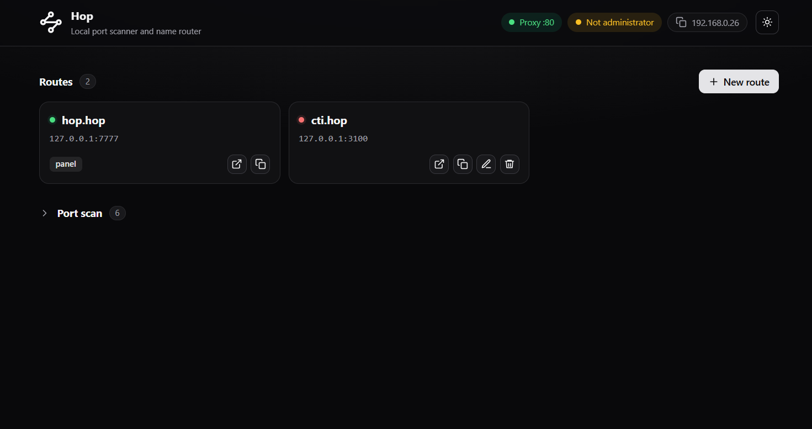

<p align="center">
  
</p>

<h1 align="center">Hop</h1>

<p align="center">
  A tiny tool that scans your machine for open ports and gives them memorable names.
</p>

---

## Purpose

Local development usually means juggling a pile of port numbers: the API on `3100`, the frontend on `5173`, a database admin on `8081`, and so on. Remembering which is which gets old fast.

Hop fixes that in two steps:

1. **Scan** the local machine (and optionally your local network) to find open ports. Each result is identified with a quick HTTP probe, so you see page titles and server names instead of bare numbers.
2. **Name** the ports you care about. Typing `cti.hop` in the browser opens `localhost:3100`. The control panel itself lives at `http://hop.hop`.

Highlights:

- Works on Windows, macOS and Linux.
- Uses only the Python standard library, with no third-party dependencies.
- Passes WebSocket traffic through, so hot reload (HMR) keeps working.
- Only edits its own clearly marked block in your hosts file and leaves the rest untouched.
- Names ending in `.localhost` work without any hosts file changes.

## Screenshots



## Installation

### Requirements

- Python 3.9 or newer
- Administrator (Windows) or root (Linux and macOS) rights are recommended. They allow Hop to listen on port 80 and to write the hosts file. Without them, Hop still runs: the proxy falls back to port 8080 and Hop shows you the lines to add to your hosts file by hand.

### Get the code

```bash
git clone <repository-url>
cd hop
```

### Run directly

```bash
# Linux and macOS (port 80 and the hosts file need root)
sudo python3 -m hop

# Windows (run the terminal as Administrator)
python -m hop
```

### Or install it

```bash
pip install .
sudo hop          # on Windows, run `hop` from an Administrator terminal
```

Once Hop is running, open the address it prints (normally `http://hop.hop`), scan a port range, and click **Name it** next to any result.

### Command-line options

| Option                           | Description                                                      |
| -------------------------------- | ---------------------------------------------------------------- |
| `--tld xyz`                      | Default suffix (`cti` becomes `cti.xyz`)                         |
| `--panel name`                   | Panel address, served at `<name>.<tld>`                          |
| `--ui-port N` / `--proxy-port N` | Panel port (default 7777) and proxy port (default 80, then 8080) |
| `--config-dir`, `--hosts-file`   | Where routes are stored and which hosts file to edit             |
| `--no-browser`                   | Do not open the browser on start                                 |
| `-v`, `--verbose`                | Verbose logging                                                  |
| `--version`                      | Print the version and exit                                       |

## Test

The test suite uses the standard `unittest` module, so nothing extra needs to be installed. Run it from the project root:

```bash
python -m unittest discover -s tests -v
```

The tests use temporary files and local sockets only. They never touch your real hosts file.
